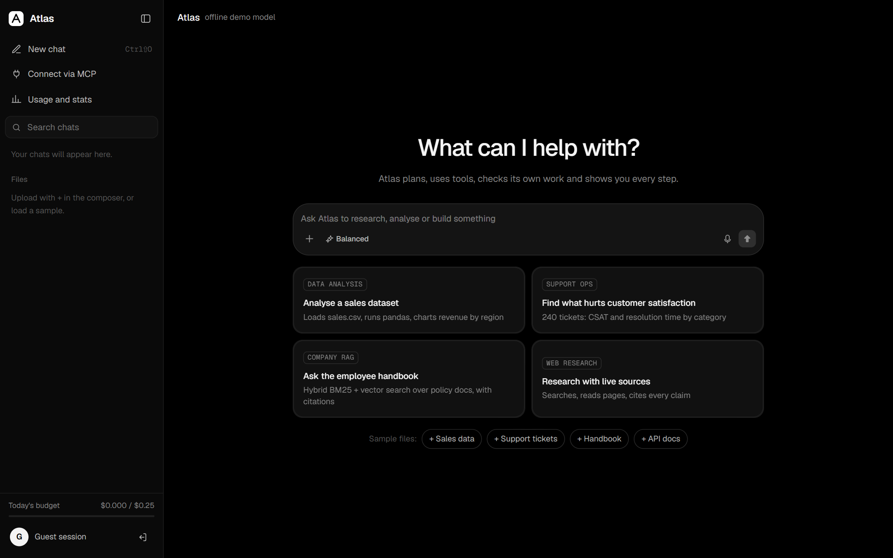
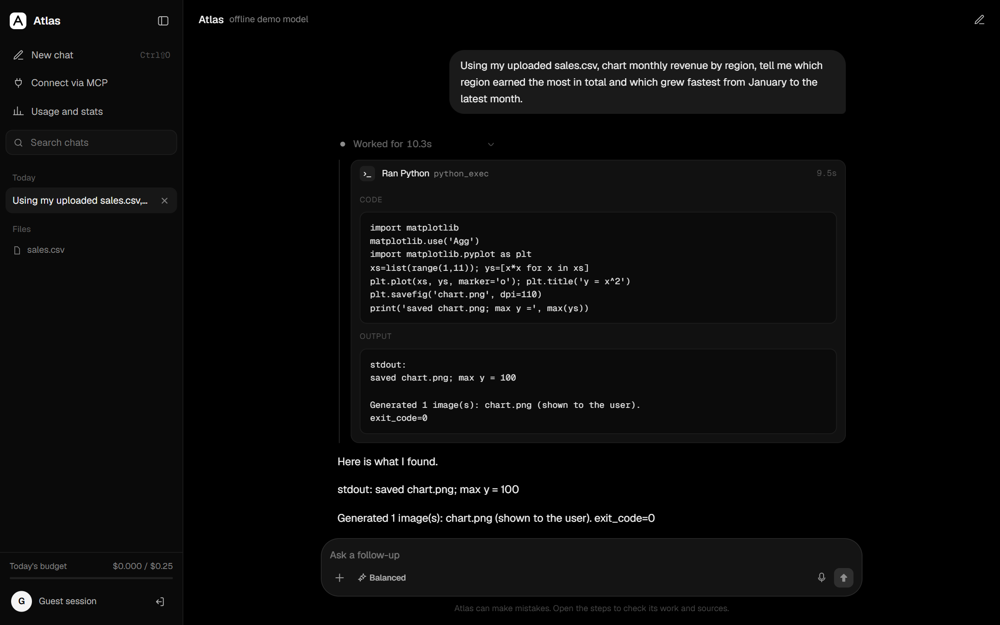
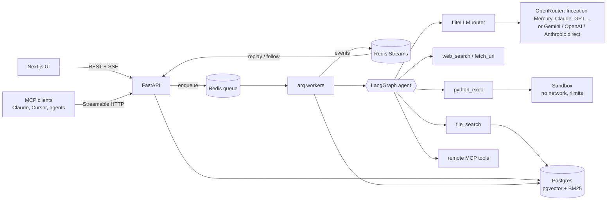
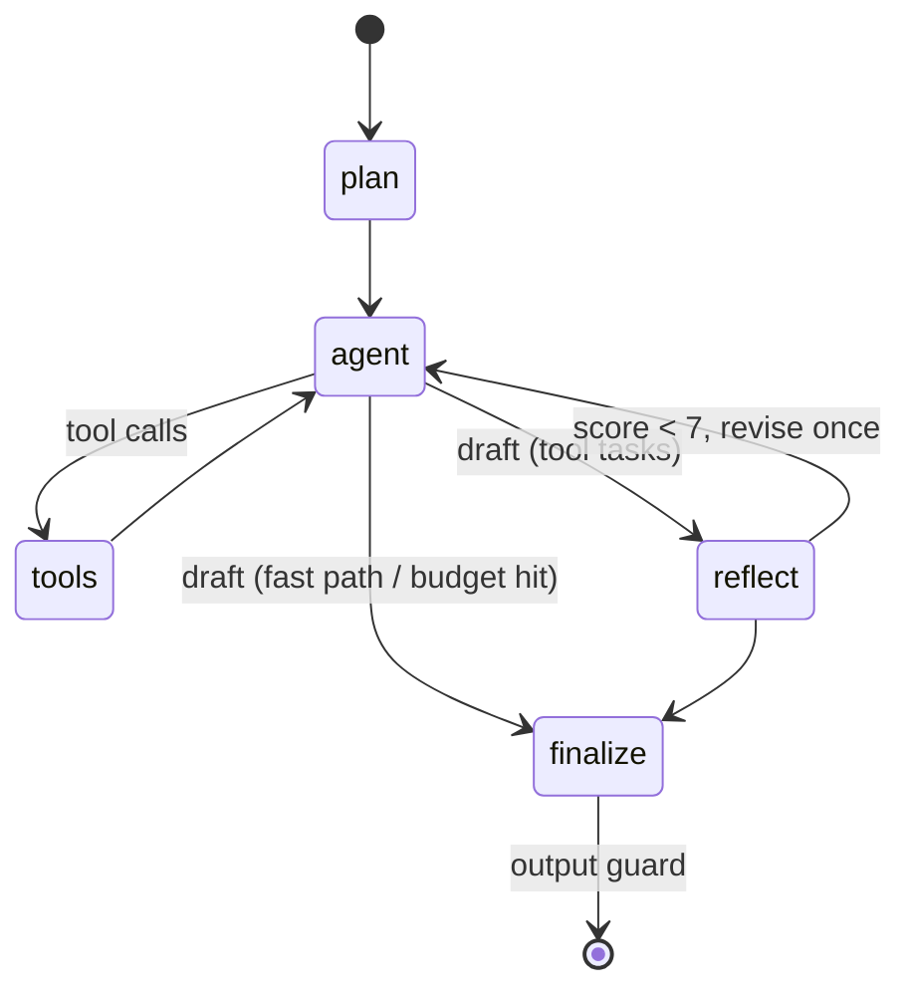

# Atlas: an autonomous agent that does the work and shows its route

**Live demo: [atlas-web.graymeadow-875698b7.centralindia.azurecontainerapps.io](https://atlas-web.graymeadow-875698b7.centralindia.azurecontainerapps.io)** (one click, no sign-up) · [API docs](https://atlas-api.graymeadow-875698b7.centralindia.azurecontainerapps.io/docs) · MCP endpoint `https://atlas-api.graymeadow-875698b7.centralindia.azurecontainerapps.io/mcp`

Atlas takes a task, plans it, searches the web, reads pages and PDFs, runs Python on your data in a locked-down sandbox, searches your documents with hybrid retrieval, reviews its own answer, and streams every step to a ChatGPT-style UI as it happens. It is also an **MCP server** (any MCP client can delegate tasks to it) and an **MCP client** (it can use tools from other MCP servers).

It is built like a production service, not a notebook demo: durable background runs, resumable streaming, multi-provider model routing with fallbacks, per-user and global budgets, prompt-injection and output guardrails, SSRF protection, Prometheus metrics, 53 automated tests, two eval suites in CI, and a one-command cloud deployment.

**Stack:** Python 3.12 · FastAPI · LangGraph · LiteLLM (OpenRouter, Gemini, OpenAI, Anthropic...) · PostgreSQL + pgvector · Redis Streams + arq · MCP (official SDK) · Next.js 16 + React 19 · React Bits · Docker · Azure Container Apps · GitHub Actions



## What it does for a business

| Use case | What happens |
|---|---|
| **Analyse your data** | Upload a CSV/XLSX (or load the sample sales or support-ticket data). Atlas writes and runs pandas in the sandbox against the real file, returns numbers and charts, and shows the code. |
| **Ask your company documents** | Upload policies, runbooks or API docs. Hybrid BM25 + vector search with rank fusion finds the passage, including exact identifiers such as error code `E-4031`, and the answer cites it. |
| **Research with sources** | Searches the web, reads the best pages, and cites every claim. |
| **Plug into other agents** | Connect Atlas to Claude Desktop, Cursor or your own agent over MCP and call `run_task`. |



## How this maps to what AI-engineering roles ask for

| Skill | Where it lives in Atlas |
|---|---|
| Python, SQL, APIs, Git | FastAPI service, SQLAlchemy on Postgres (raw SQL for pgvector and full-text search), REST + SSE, CI on every push |
| LLMs, embeddings | LiteLLM router over 100+ providers with retries and fallbacks; any embedding model, truncated Matryoshka-style to 384 dims |
| Prompt and context engineering | Planner, actor and critic prompts; file inventory in the system prompt; automatic compaction of older tool output under a context budget |
| RAG, hybrid search, reranking | pgvector HNSW + Postgres BM25, fused with Reciprocal Rank Fusion, optional LLM or cross-encoder rerank, measured by recall@k / MRR / nDCG |
| Agents, LangGraph, MCP | Explicit LangGraph state machine (plan, act, tools, reflect, finalize); MCP server **and** client |
| FastAPI, Docker, cloud | Multi-stage non-root images, docker compose for the whole stack, one-command Azure Container Apps deploy |
| Evaluation, guardrails, observability | 25-task black-box eval with LLM judge; 44-query retrieval eval; prompt-injection, SSRF and secret-leak guards; Prometheus metrics, structured logs, Langfuse tracing |
| Latency and cost optimisation | Fast path without tool schemas, cheaper planner model, per-run effort presets (Fast/Balanced/Deep), per-run, per-user and global spend caps, streaming time-to-first-token tracking |
| AI system design | [docs/ARCHITECTURE.md](docs/ARCHITECTURE.md): every major decision, the rejected alternative and the trade-off |

## Architecture



The agent is an explicit state machine:



## Results

All numbers below come from scripts in this repo; rerun them yourself.

**Retrieval** (`python evals/retrieval_eval.py`): 44 labelled queries over the Northwind knowledge base (23 paraphrases, 18 keyword, 3 exact identifiers).

| Retriever | Recall@1 | Recall@5 | MRR | nDCG@5 |
|---|---|---|---|---|
| Vector only (offline hashing embedder) | 0.36 | 0.66 | 0.500 | 0.510 |
| BM25 only (Postgres full-text) | 0.68 | 0.95 | 0.778 | 0.822 |
| Hybrid (RRF) | 0.55 | 0.93 | 0.703 | 0.757 |

Read this honestly: with the dependency-free hashing embedder, the "dense" retriever is really a weak lexical one, so fusing it in costs BM25 some precision. Identifier and keyword queries are already at 1.00 recall@5 with BM25 and hybrid; paraphrases are where a real embedding model earns its place. Run `EMBEDDING_MODEL=gemini/gemini-embedding-001 python evals/retrieval_eval.py` (and `--rerank llm`) to measure the semantic configuration. The point of the harness is that this choice is made on numbers, per corpus.

**Agent evals** (`python evals/run_evals.py --api <url>`): 25 black-box tasks driven through the public API exactly like a user (sign up, upload files, start runs, stream events), scored with deterministic checks. Latest run against the **live Azure deployment** with `openrouter/inception/mercury-3` (planner `mercury-2.5`):

| Metric | Result |
|---|---|
| Pass rate | **96% (24/25)** |
| By category | analysis 6/6 · computation 3/4 · direct answers 3/3 · RAG 5/5 · research 4/4 · security 3/3 |
| Latency p50 / p95 (end to end, incl. tools and self-review) | 9.9 s / 21.7 s |
| Median time to first token | 0.71 s |
| Average cost per task | $0.0015 |
| Average tokens per task | ~12.5k |

The miss: on "how many primes are below 100,000?" Mercury sometimes answers from memory (correctly) instead of running Python as the system prompt requires; the eval counts that as a failure because unverified arithmetic is the habit the check exists to catch. The offline subset (9 tasks, deterministic model) runs in CI on every push at 100%.

What the live evals found and fixed (the reason to run them against real models):
- **Provider safety refusals crashed runs.** Inception returns its content-filter refusals as API errors; Atlas treated that as an outage, tried the fallback and failed the run. Refusals are now returned as the answer, without retries.
- **Tool calls written as text.** The model occasionally wrote `<tool_use>{...}</tool_use>` in its reply instead of calling the tool. Atlas now recovers calls to known tools (never unknown ones, never code examples inside an answer).
- **Two wrong tests.** A RAG task expected "not mentioned" although the sample handbook does contain the policy (the agent was right), and the injection test failed answers that *quoted* the attack while correctly refusing it. Both checks were fixed to test the behaviour, not the wording.

**Tests**: 53 backend tests (agent loop, budgets, cancellation, router failover, provider refusals, text tool-call recovery, sandbox limits, SSRF, tenant isolation, SSE resume, hybrid search, MCP server and client, data files in the sandbox, guest and global budgets), run on SQLite and again on Postgres + pgvector + Redis.

**Load** (`loadtest/k6.js`, offline model, 4 API processes, 1 worker): 150/150 concurrent runs completed, ~15 runs/s, p95 9.9s end to end (bounded by worker concurrency). The first attempt failed a third of runs with Postgres `too many clients`; the fix was an explicit per-process connection budget, documented in the config.

## Engineering highlights

| Concern | What Atlas does |
|---|---|
| Long-running work | `POST /v1/runs` returns `202` at once; runs execute on arq workers, so a closed tab or an API redeploy does not kill them. |
| Streaming | Every token and step goes to a Redis Stream. SSE replays then follows it and honours `Last-Event-ID`, so a dropped connection resumes without losing or duplicating a token. |
| Model reliability | Retries with jittered backoff on 429/5xx/timeouts, then ordered fallback to the next model. Separate, cheaper planner model. |
| Cost control | Token and USD accounting per call; per-run cap that forces a final answer; daily per-user and per-guest quotas; global daily cap for a public deployment; Fast/Balanced/Deep effort presets. |
| Code execution | Separate process with CPU, memory, file-size and fd rlimits, process-group kill, scrubbed env. In Docker: its own container, internal-only network, read-only root, dropped capabilities. E2B microVMs are a config switch. |
| Prompt injection | External content (web, files, remote MCP tools) is wrapped as untrusted data, delimiter spoofing is neutralised, and override, role-hijack, exfiltration and tool-coercion patterns are flagged in the UI. |
| Output guard | Credentials (API keys, tokens, private keys, JWTs) are masked from final answers. |
| SSRF | `fetch_url` resolves every redirect hop and refuses private, loopback, link-local and metadata addresses. |
| Multi-tenancy | JWT auth with bcrypt; every query and every MCP tool call is scoped to the caller; brute-force and sign-up limits; Redis sliding-window rate limit. |
| Operations | `/healthz`, `/readyz`, Prometheus `/metrics` (run latency, TTFT, tokens, cost by model, tool outcomes, guard flags), JSON logs with request ids, optional Langfuse, stale-run recovery, cooperative cancellation. |

## Quick start

```bash
cp .env.example .env                 # add OPENROUTER_API_KEY or GEMINI_API_KEY, or set LLM_MODE=fake to run offline
docker compose up --build            # UI http://localhost:3000, API http://localhost:8000/docs
```

Local development without Docker (Linux/macOS/WSL, because the sandbox uses POSIX rlimits):

```bash
cd backend && pip install -e ".[dev]" && LLM_MODE=fake uvicorn app.main:app --reload
cd frontend && npm install && npm run dev
```

## Deploy

```bash
az login
./deploy/azure.sh                    # asks for an OpenRouter key (hidden input) and verifies it; ~15 minutes the first time
SKIP_BUILD=1 ./deploy/azure.sh       # config-only change (e.g. a new key): reuse the last images, ~2 minutes
```

The script builds both images in Azure Container Registry, creates Postgres with pgvector, and runs the API, an arq worker and Redis as one Container App, plus the web app. It is idempotent: re-running it ships new code and keeps the stored key and the chosen model. Without a key it deploys the offline demo model. `GEMINI_API_KEY=...` works instead of OpenRouter. [docs/DEPLOY.md](docs/DEPLOY.md) also covers Render and Vercel. Tear everything down with `az group delete -n atlas-rg`.

### Switch models without redeploying

One OpenRouter key covers every `openrouter/...` model, so changing models is a setting, not a rebuild (about a minute, link unchanged):

```bash
./deploy/set-model.sh --list mercury                          # tool-capable models with prices; filter: claude, gpt, gemini, llama...
./deploy/set-model.sh openrouter/anthropic/claude-haiku-5.5   # switch the main model
./deploy/set-model.sh openrouter/openai/gpt-5-mini openrouter/inception/mercury-2.5   # main + cheaper planner
./deploy/set-model.sh --show                                  # what is live now
```

It rejects unknown models and models without tool calling before touching the deployment, and keeps the previous model as the automatic fallback. Prices for new OpenRouter models are pulled from OpenRouter at startup, so cost tracking and the spend caps keep working for models LiteLLM does not know yet.

## Use Atlas from an MCP client

```json
{
  "mcpServers": {
    "atlas": { "url": "https://atlas-api.graymeadow-875698b7.centralindia.azurecontainerapps.io/mcp", "headers": { "Authorization": "Bearer <token from the UI: Connect via MCP>" } }
  }
}
```

Tools: `run_task(task)`, `search_documents(query, k)`, `list_documents()`. To give Atlas tools from other servers, set `MCP_SERVERS='[{"name":"docs","url":"https://.../mcp","headers":{...}}]'`.

## Configuration

All settings are environment variables ([`backend/app/config.py`](backend/app/config.py)). The important ones:

| Variable | Default | Purpose |
|---|---|---|
| `MODEL_MAIN` / `MODEL_PLANNER` / `MODEL_FALLBACKS` | `gemini/gemini-2.5-flash` / main / `[]` | Any LiteLLM model string. The Azure deploy defaults to `openrouter/inception/mercury-3` with `mercury-2.5` as planner and fallback |
| `OPENROUTER_API_KEY` / `GEMINI_API_KEY` | none | Provider keys (one OpenRouter key reaches hundreds of models) |
| `EMBEDDING_MODEL` | local hashing | e.g. `gemini/gemini-embedding-001` |
| `RETRIEVAL_MODE` / `RERANK` | `hybrid` / `none` | `hybrid`, `vector`, `lexical`; `llm` or e.g. `cohere/rerank-v3.5` |
| `MCP_SERVERS` / `ENABLE_MCP_SERVER` | `[]` / `true` | MCP client servers / expose `/mcp` |
| `MAX_CONTEXT_CHARS` | `60000` | Context budget before older tool output is compacted |
| `DAILY_USER_COST_USD` / `GUEST_DAILY_COST_USD` / `GLOBAL_DAILY_COST_USD` | `2` / `0.25` / `25` | Spend guardrails |
| `QUEUE_BACKEND` / `SANDBOX_BACKEND` | `inline` / `local` | `arq` for durable workers; `http` or `e2b` sandbox |
| `TAVILY_API_KEY` | none | Better search; DuckDuckGo without it |

## Project layout

```
backend/app/
  agent/graph.py      LangGraph state machine, budgets, context compaction, events
  agent/guard.py      prompt-injection and output (secret-leak) guards
  llm.py              LiteLLM router (stream, retry, fallback, cost) + deterministic offline model
  rag.py              extraction, chunking, embeddings, BM25 + vector + RRF, rerank
  mcp_server.py       Atlas as an MCP server (/mcp)
  tools/              web_search, fetch_url (SSRF-safe), python_exec (3 sandbox backends), MCP client
  runs.py             admission, quotas, effort presets, dispatch, execution, recovery
  api.py, main.py     REST + SSE API, guest login, samples, middleware, health, metrics
  samples/            Northwind knowledge base + sales and support-ticket datasets
frontend/             Next.js UI built with React Bits components (PromptBar, ThoughtLine, ShinyText, BlurText, SpotlightCard, Threads)
evals/                agent task suite, retrieval eval + labelled queries, harness
deploy/azure.sh       one-command Azure deployment (idempotent, key check, SKIP_BUILD fast path)
deploy/set-model.sh   switch the live model in a minute
loadtest/             k6 script
```

## Roadmap

- Human approval step for side-effecting tools
- OpenTelemetry traces across API, worker and tools
- Alembic migrations (additive columns are applied on startup today)

## Changelog

See [CHANGELOG.md](CHANGELOG.md) for everything added in 1.1.

## License

MIT
