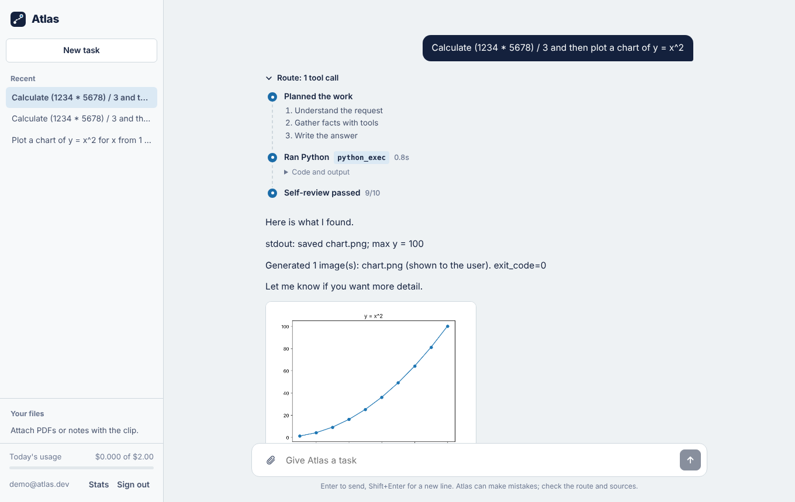
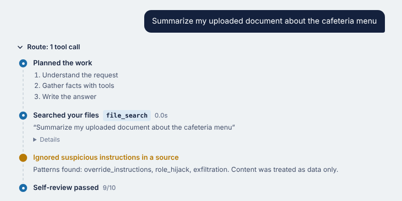
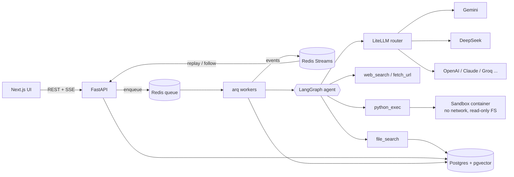
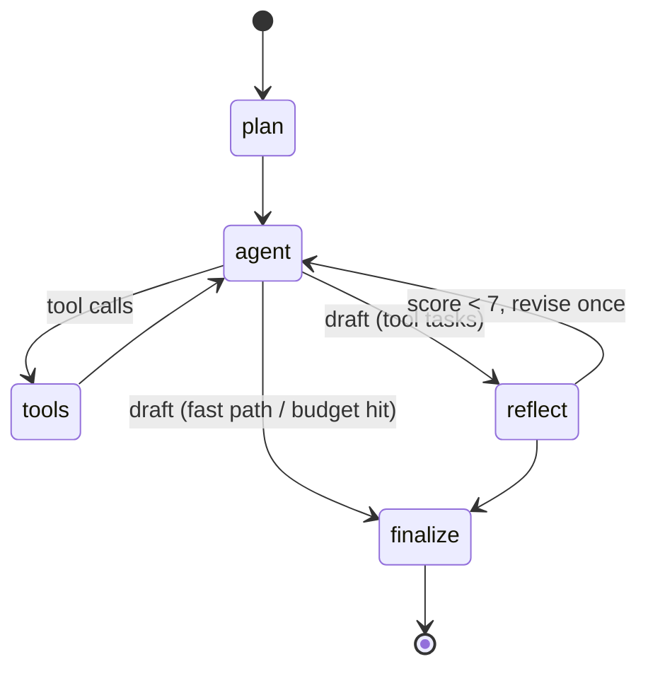

# Atlas: an autonomous agent that does the work and shows its route

Atlas takes a task, plans it, searches the web, reads pages and PDFs, runs Python in a locked-down sandbox, searches your own uploaded documents, reviews its own answer, and streams every step to the UI as it happens.

It is built like a production service, not a notebook demo: durable background runs, resumable streaming, multi-provider model routing with fallbacks, per-user budgets and rate limits, prompt-injection defenses, SSRF protection, Prometheus metrics, an eval harness in CI, and a containerised deployment.



## What it does

- **Plans, then acts.** A planner decides whether a request needs tools. Simple questions take a fast path with no tool schemas (cheaper and quicker); real tasks run the full loop.
- **Uses tools in parallel.** Web search (Tavily, DuckDuckGo fallback), page and PDF reading, a Python code interpreter that returns charts, and hybrid search over the user's files.
- **Checks itself.** A critic scores the draft against the evidence the agent gathered. Low scores trigger one revision.
- **Shows its route.** Plan, every tool call with code and output, guard warnings and the self-review appear live as waypoints, and are saved with the answer.
- **Stays inside budgets.** Hard caps on steps, tool calls and dollars per run, plus a daily spend limit per user.



## Architecture



The agent itself is an explicit state machine:



More detail on each decision is in [docs/ARCHITECTURE.md](docs/ARCHITECTURE.md).

## Engineering highlights

| Concern | What Atlas does |
|---|---|
| Long-running work | `POST /v1/runs` returns `202` with a run id at once. Runs execute on arq workers, so a closed tab or an API redeploy does not kill them. |
| Streaming | Every token and step goes to a Redis Stream. The SSE endpoint replays and then follows it, and honours `Last-Event-ID`, so a dropped connection resumes without losing or duplicating a token. The UI reattaches to an in-flight run after a refresh. |
| Model reliability | One interface over 100+ providers via LiteLLM: retries with exponential backoff on 429/5xx/timeouts, then ordered fallback to the next provider. Separate planner and main model so planning can run on a cheaper model. |
| Cost control | Per-call token and USD accounting, per-run cost cap that forces a final answer, daily per-user spend quota, fast path that skips tool schemas. |
| Code execution | Separate process with CPU, memory, file-size and fd rlimits, wall-clock kill of the whole process group, scrubbed environment. In Docker it runs in its own container on an internal-only network with a read-only root filesystem, dropped capabilities and a pids limit. E2B microVMs are a config switch away. |
| Prompt injection | All external content is wrapped as untrusted data, delimiter spoofing is neutralised, and heuristics flag override, role-hijack, exfiltration and tool-coercion attempts. Flags are shown in the UI, logged and counted. |
| SSRF | `fetch_url` resolves every hop (redirects are followed manually) and refuses loopback, private, link-local and cloud-metadata addresses. |
| RAG | PDF/text extraction, overlapping chunks, embeddings (any provider, or a dependency-free local fallback), HNSW index on pgvector, hybrid re-ranking (0.7 vector + 0.3 lexical) so exact identifiers are not lost. Strictly scoped per user. |
| Multi-tenancy | JWT auth with bcrypt, every query filtered by owner, brute-force limits on login and signup, sliding-window rate limit shared across replicas through Redis. |
| Operations | `/healthz`, `/readyz` (DB + Redis), Prometheus `/metrics` (run latency, time to first token, tokens, cost per model, tool success, guard flags), structured JSON logs with request ids, optional Langfuse tracing, stale-run recovery on startup, cooperative cancellation. |
| Quality gates | 36 backend tests (agent loop, budgets, cancellation, router failover, sandbox limits, SSRF, isolation, SSE resume) run on SQLite and again on Postgres + Redis in CI. A black-box eval suite with deterministic checks and optional LLM-as-judge runs offline on every push and live nightly. |

## Quick start

### Everything in Docker

```bash
cp .env.example .env          # add at least one model key, e.g. GEMINI_API_KEY (free tier works)
docker compose up --build
```

Open http://localhost:3000. API docs are at http://localhost:8000/docs.

No key yet? Set `LLM_MODE=fake` in `.env` to run the whole stack on a deterministic offline model.

### Local development

```bash
# backend
cd backend
pip install -e ".[dev]"
LLM_MODE=fake uvicorn app.main:app --reload       # SQLite + in-memory bus, no other services needed

# frontend
cd frontend
npm install && npm run dev
```

## Configuration

All settings are environment variables (see [`backend/app/config.py`](backend/app/config.py)). The important ones:

| Variable | Default | Purpose |
|---|---|---|
| `MODEL_MAIN` | `gemini/gemini-2.5-flash` | Any LiteLLM model string |
| `MODEL_PLANNER` | same as main | Cheaper model for planning and self-review |
| `MODEL_FALLBACKS` | `[]` | e.g. `["deepseek/deepseek-chat","openai/gpt-4o-mini"]` |
| `EMBEDDING_MODEL` | local hashing | e.g. `gemini/text-embedding-004` |
| `TAVILY_API_KEY` | none | Better search; DuckDuckGo is used without it |
| `QUEUE_BACKEND` | `inline` | `arq` for durable Redis workers |
| `SANDBOX_BACKEND` | `local` | `http` (sandbox container) or `e2b` |
| `MAX_RUN_COST_USD` / `DAILY_USER_COST_USD` | `0.25` / `2.0` | Spend guardrails |
| `MAX_AGENT_STEPS` / `MAX_TOOL_CALLS_PER_RUN` | `8` / `12` | Loop guardrails |
| `DB_POOL_SIZE` / `DB_MAX_OVERFLOW` | `5` / `5` | Per-process Postgres connection budget |

## Testing and evals

```bash
cd backend && pytest -q                                         # unit + API tests
TEST_DATABASE_URL=postgresql+asyncpg://... TEST_REDIS_URL=redis://... pytest -q   # integration

python evals/run_evals.py --offline --min-pass 1.0              # against a running API, fake model
python evals/run_evals.py --judge-model gemini/gemini-2.5-flash # live model + LLM judge
```

The eval suite has 21 tasks across computation, analysis, RAG, research, direct answers and security (file-borne prompt injection, SSRF to the metadata endpoint, system-prompt extraction). It writes `evals/results/report.md` with pass rate by category, p50/p95 latency, time to first token, tokens and cost per task.

## Load testing

`loadtest/k6.js` ramps concurrent users that each start a run and stream it to completion. Measured on a single machine with the offline model, 4 API processes and 1 worker (`max_jobs=20`), 150 simultaneous runs:

| Metric | Result |
|---|---|
| Runs completed | 150 / 150 |
| Throughput | ~15 runs/s |
| End-to-end p50 / p95 | 6.1s / 9.9s (bounded by worker concurrency; add workers to scale) |

The first load test failed a third of runs with `too many clients` from Postgres: four API processes and a worker each held a 30-connection pool against a 100-connection server. The fix was an explicit connection budget per process (`DB_POOL_SIZE`, `DB_MAX_OVERFLOW`, `pool_timeout`) and a rule in the config docs: processes x (pool + overflow) must stay under `max_connections`, or put PgBouncer in front.

Rerun these numbers against your own deployment and a live model before quoting them.

## Deploying

See [docs/DEPLOY.md](docs/DEPLOY.md) for Render (blueprint included), Azure Container Apps and Vercel.

## Project layout

```
backend/app/
  agent/graph.py      LangGraph state machine: plan, act, tools, reflect, budgets, events
  agent/guard.py      prompt-injection defenses
  llm.py              LiteLLM router (stream, retry, fallback, cost) + deterministic fake model
  tools/              web_search, fetch_url (SSRF-safe), python_exec (3 sandbox backends)
  rag.py              extraction, chunking, embeddings, pgvector + hybrid retrieval
  runs.py             run lifecycle: quota, dispatch, execution, persistence, recovery
  infra.py            Redis Streams event bus, rate limiter, cancel flags (+ in-memory twins)
  api.py, main.py     REST + SSE API, middleware, health, metrics
  worker.py           arq worker
sandbox/              isolated code-execution service
frontend/             Next.js UI (route view, streaming, files, usage)
evals/                task suite, fixtures, harness
loadtest/             k6 script
```

## Roadmap

- MCP client so users can connect their own tools (GitHub, Notion, Gmail)
- OpenTelemetry traces across API, worker and tools
- Alembic migrations (schema is created on startup today)
- Human approval step for side-effecting tools

## License

MIT
